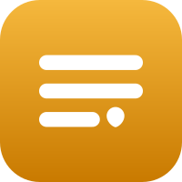
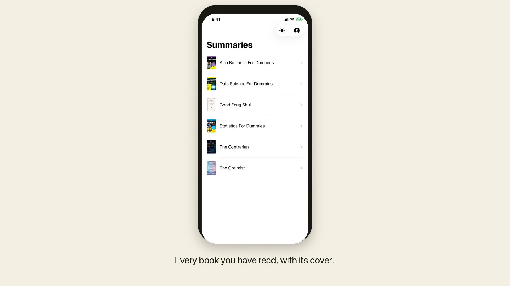

  [](https://apps.apple.com/us/app/kernel/id6792376485)

**Kernel.** You finish a book. A month later you remember one idea. Kernel keeps the rest: every chapter in plain words, read it or listen to it.

[](https://github.com/nulljosh/kernel/releases/download/v1.0.2/kernel-ad.mp4)

Free on the [web](https://bookrank.jaybulb.com), $0.99 on iPhone, iPad and Mac. Formerly Bookrank.

- **Chapters.** Open a book, pick a chapter, read it.
- **Listen.** One narrator explains the chapter while the words light up.
- **Highlights and questions.** Save a line, or ask the chapter something.
- **Goodreads.** Your shelves show up next to your summaries.
- **Search.** Find words inside your chapters, or ideas close in meaning.
- **Bring your books.** Photos of pages, EPUB and PDF, Kindle and Readwise highlights.
- **Four languages.** English, French, Spanish and German, narration included.
- **Read your way.** Light, dark, sepia or true black; your place is saved whether you listen or read.
- **Offline.** Your books stay on the device, the apps download the audio, and saves made offline go up later.
- **Yours.** Export everything as one zip. Deleting your account deletes all of it.

## Run it

```
node --test              # tests
sh scripts/build-site.sh # builds dist/, then wrangler pages deploy dist
```

The apps come from `ios/project.yml` with xcodegen.

[Changelog](docs/CHANGELOG.md) · [Roadmap](roadmap.md) · [Architecture](docs/ARCHITECTURE.md) · [API](docs/API.md) · [Shipping](docs/SHIPPING.md) · [Whitepaper](WHITEPAPER.md)
